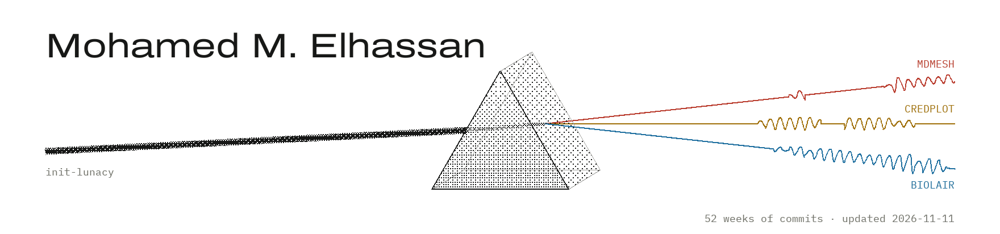

<a href="https://mohames.com">
  <picture>
    <source media="(prefers-color-scheme: dark)" srcset="banner/banner-dark.png">
    
  </picture>
</a>

Electrical engineering at MSU Denver. Lead System Architect at Qureway since 2023.
Building [MDMesh](https://github.com/MDMesh-app/MDMesh), CredPlot, RouteSpine and Biolair.

**[mohames.com](https://mohames.com)**
